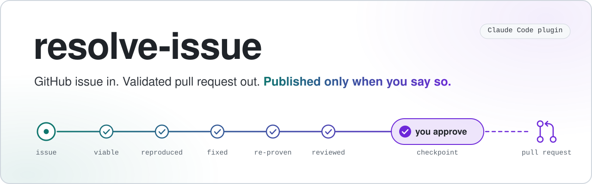
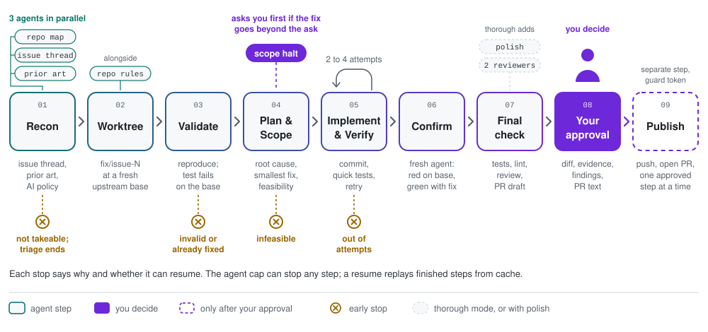

<p align="center">
  <picture>
    <source media="(prefers-color-scheme: dark)" srcset="assets/banner-dark.svg">
    <source media="(prefers-color-scheme: light)" srcset="assets/banner-light.svg">
    
  </picture>
</p>

<p align="center">
  <a href="https://github.com/TLXyloph/resolve-issue/actions/workflows/ci.yml"></a>
  <a href="LICENSE"></a>
  <a href="#quick-start"></a>
  <a href="CHANGELOG.md"></a>
</p>

**Give it a GitHub issue. Get back a tested fix and a drafted pull request. Nothing is published until you approve.**

resolve-issue is a Claude Code plugin for people who contribute to other people's open-source projects. It works on your own repositories too. For one issue, it:

- checks that the issue is still free: no competing PR, recent claim or unmerged fix;
- reproduces the bug with a test that fails on the current code;
- fixes it, then has a fresh agent run the tests on the old code and on the fix;
- reviews the change as a maintainer would and drafts the PR in the project's format;
- stops and shows you the diff, the commits, the test evidence, the findings and the PR text.

## Quick start

Install the plugin in Claude Code (2.1.275 or later):

```
/plugin install resolve-issue --marketplace TLXyloph/resolve-issue
```

Open Claude Code in the folder that holds your clone of the project, or in a folder above it. If there is no clone, the run makes one there. When that folder is inside an unrelated repository, the clone goes next to that repository's main clone instead, also when the folder is a worktree such as Claude Code's `.claude/worktrees/<name>`. When the folder is in a submodule, nested or not, the clone goes next to the main clone of the outermost superproject. Start with a triage run. Triage uses two agents, clones nothing and changes nothing, and took 30 to 60 seconds in our tests:

```
/resolve-issue https://github.com/OWNER/REPO/issues/123 triage
```

Triage answers "is this issue worth taking?" It returns a verdict, the reasons, the repository's AI-contribution policy and a suggested mode. An open issue is often already taken: in our tests, 9 of 10 open, unassigned bugs already had someone on them ([details](#built-for-contributing-to-other-peoples-projects)). If the issue is takeable, run the fix:

```
/resolve-issue https://github.com/OWNER/REPO/issues/123
```

The skill asks once before it spends tokens, with the time and tokens measured for that mode, then runs in the background. `/workflows` shows progress and per-agent token use. When the run ends, you get an approval packet. Nothing is published until you answer it.

<details>
<summary>Other ways to install, update or remove</summary>

| Task | Command |
|---|---|
| Add the marketplace, then install | `/plugin marketplace add TLXyloph/resolve-issue`, then `/plugin install resolve-issue@resolve-issue` |
| Install from a shell | `claude plugin marketplace add TLXyloph/resolve-issue && claude plugin install resolve-issue@resolve-issue` |
| Try it without installing | `git clone https://github.com/TLXyloph/resolve-issue && claude --plugin-dir ./resolve-issue` |
| Update | In a terminal, `claude plugin marketplace update resolve-issue && claude plugin update resolve-issue@resolve-issue`, then restart Claude Code |
| Uninstall | `/plugin uninstall resolve-issue@resolve-issue` |

If another command named `resolve-issue` exists, use `/resolve-issue:resolve-issue`.

</details>

## What happens when you run it

<p align="center">
  <picture>
    <source media="(prefers-color-scheme: dark)" srcset="assets/pipeline-dark.svg">
    <source media="(prefers-color-scheme: light)" srcset="assets/pipeline-light.svg">
    
  </picture>
</p>

1. **Size the run.** The skill reads your mode and effort, checks that `gh` is logged in, and asks once. The question shows the mode, effort, model, typical agent count and cap, and the time and tokens measured for that mode. It offers a cheaper choice. Triage never asks.
2. **Recon.** Three agents work in parallel, with read-only GitHub access. One finds or clones the repository and fetches a fresh upstream base. One reads the whole issue thread. One checks prior art, competing pull requests, claims, unmerged fix branches and the AI-contribution policy. Code, not an agent, then decides whether the issue is viable. Triage mode returns its verdict here.
3. **Worktree.** It creates a git worktree `<clone>-issue-<n>` on the branch `fix/issue-<n>`, at the freshly fetched base. Your checkout is untouched. Alongside, an agent reads CONTRIBUTING, AGENTS.md, the PR template, style config, DCO and CLA rules and the commit convention.
4. **Validate.** It sets up the environment, reproduces the bug and writes an acceptance test that must fail on the base. When no environment exists, as in a fresh clone, it creates one for the worktree only: a virtualenv in `<worktree>/.resolve-issue/venv` with an editable install of the worktree for Python, the lockfile install inside the worktree for Node, and the toolchain's own fetch for Rust or Go. If the reported behavior is correct but a clearer message or doc would have prevented the report, that becomes the fix. If the issue is not a defect or is already fixed, the run stops with `invalid-issue` and a reply you can post yourself. Two other stops can be resumed. If the environment or a service the tests need cannot be set up, the run stops with `validate-blocked`: fix what it names, then resume. If the issue is real but no test fails on the base, the run stops with `no-red-test`, because a behavior fix could not be proven.
5. **Plan and scope.** It plans a fix for the root cause and scopes the smallest change, with an explicit out-of-scope list. Standard and thorough modes spike the riskiest assumptions first. If the responsible fix goes beyond the literal ask, the run halts and asks you.
6. **Implement and verify.** It implements the fix, adds or extends a regression test in the project's own test suite, commits in the repository's commit style and runs a targeted check. A failure feeds a focused retry.
7. **Confirm.** A fresh, skeptical agent re-proves the fix with a differential. The acceptance test, the reproduction and the regression test the fix added run against the base code and against the fix. For a behavior change, both tests must fail on the base and pass with the fix. Code decides the verdict by change kind (behavior, diagnostics or docs). In quick mode, one agent verifies and confirms; if it passes the targeted check but never reaches the differential, the next attempt keeps the code and checks it again.
8. **Final check.** Wider tests for the mode, lint on the changed lines, a maintainer-eye review and the PR title and body. The review receives the independent checker's notes and confirms or dismisses each one as a finding. With the no-mistakes gate, this step is a no-mistakes validation run with push, PR and CI skipped. Thorough mode (or `polish`) runs a polish pass first, and a fresh agent re-checks the polished head with the same differential. If that re-check fails, you still get the packet, with a blocker finding and a warning that names the last confirmed head. If the final check reports a head that no differential proved, a warning names both heads. Thorough mode also runs two extra reviewers beside either final check.
9. **Your approval.** You get the approval packet: summary, test evidence, the exact diff, the commits that will be published (verbatim), findings with recommendations and the PR text. Findings come recommended as fix, low-impact, decline or note. Your [autonomy level](docs/publishing.md#finding-decisions-and-autonomy) sets which ones the skill decides on its own and which it asks you about. You choose: open the PR, open it as a draft, fix findings first, or not now. The packet recommends exactly one of these.
10. **Publish.** Only after you approve. It pushes to your fork (or to the repository, if you can push there and choose to) and opens the PR with the text you approved. It checks that the fork really is a fork of the upstream repository, and pushes with your `gh` login without waiting for a password. Publishing from a later session first re-checks that the issue is still free.

Every stop returns its reason and says how to resume, or that the stop is final. A resume replays finished steps from cache. See [docs/how-it-works.md](docs/how-it-works.md) for each step and the design choices behind it.

## Modes and effort

The **mode** sets how much work runs (speed and cost). The **effort** sets how hard each agent thinks. They are independent.

| Mode | What runs | Typical agents | Cap |
|---|---|---|---|
| `triage` | Issue thread, prior art and viability only. No clone. | 2 | 6 |
| `quick` | Recon, worktree, rules, reproduction, one plan-and-scope step, the fix, one combined skeptical check, a light final review. 2 attempts. | ~10 | 20 |
| `standard` (default) | Adds a separate scope step, a feasibility spike with up to 2 re-scope rounds, separate verify and confirm agents, and tests for the affected modules. 3 attempts. | ~14 | 40 |
| `thorough` | Up to 3 feasibility rounds, 4 attempts, a polish pass and its re-check, two extra reviewers, and the full test suite when it fits in about 15 minutes. | ~19 | 64 |

"Typical" means a run with no retries. Retries, extra attempts and re-scopes add agents. The test scope applies to the built-in final check; with the no-mistakes gate, its own test step runs instead.

The cap is enforced in code: at the cap, the run stops with `agent-budget-reached` and tells you how to resume with a larger `maxAgents`. One exception: thorough mode's two extra reviewers take only the slots the cap leaves after one for the final check, so near the cap the packet comes back without them, and `warnings` says so. If Claude Code's own token budget for the turn runs out, the run stops with `token-budget-reached` instead.

Measured time and tokens:

| Run | Agents | Time | Tokens | Measured on |
|---|---|---|---|---|
| `triage` | 2 | 30 to 60 s | about 90k to 110k | 10 runs on real issues |
| `quick`, `standard` or `thorough`, stopped at the viability check | 3 | about 1 min | about 160k | one real issue |
| `quick` | 10 | 7–8 min | about 570–580k | 2 runs on one real issue |
| `standard` | 14 | 11–12 min | about 760–780k | 2 runs on one real issue |
| `thorough` | 19–20 | 16–20 min | about 1.05–1.14M | 2 runs on one real issue |

These figures come from Claude Code 2.1.296 on macOS, with Claude Opus 5.5 as the session model and effort `medium`. Tokens are the total tokens processed by the run's agents, as Claude Code's workflow usage reports them; most of them are cached input. The quick, standard and thorough runs were on the same real, open bug report in [Pelican](https://github.com/getpelican/pelican) (a static site generator with about 13k stars), twice per mode, and every run reached the approval packet. In each, the regression test failed on the base and passed with the fix. The agents also ran the whole test suite, and it passed (321 to 324 tests); only thorough mode asks for the whole suite. No pull request was opened. These are measurements, not guarantees: time varies most with the repository's test suite and environment setup. `/workflows` shows the live per-agent token use of your own run.

| Effort | Bookkeeping | Recon and rules | Validate, plan, build | Verify, confirm, review |
|---|---|---|---|---|
| `low` | low | low | medium | medium |
| `medium` (default) | low | medium | high | high |
| `high` | low | medium | xhigh | xhigh |
| `max` | medium | high | max | max |
| `inherit` | every agent uses your session's effort | | | |

If the model does not support a level, it falls back to the model's highest supported level at or below it. `model=<alias or ID>` (for example `sonnet`, `opus`, `haiku` or `fable`) runs every agent on that model. Without it, agents use your session's model.

Other arguments:

| Argument | Effect |
|---|---|
| `attempts=N` | Implementation attempts, 1 to 8. A value outside the range stops the run with `bad-args`. |
| `maxAgents=N` | A hard cap on agent calls, 4 to 200. A value outside the range stops the run with `bad-args`. |
| `polish` | Adds the polish pass in any mode. |
| `gate=auto\|builtin\|no-mistakes` | The final check. `auto` uses [no-mistakes](https://github.com/kunchenguid/no-mistakes) when the repository is already set up for it, and the built-in check otherwise. |
| `force` | Goes past soft viability stops: closed issue, competing PR, claim, work in progress, a wontfix, invalid or duplicate label. It never overrides an archived repository, a repository that rejects AI-assisted work, or your own open PR. |
| `yes` | Skips the cost question. It never approves a publish. |
| `autonomy=ask\|minor\|full` | How much the skill decides about review findings on its own, only at validation gates, which cannot publish. Publishing always waits for you. The default is `minor`, or your configured `autonomy` ([details](docs/publishing.md#finding-decisions-and-autonomy)). Any other value makes the skill ask you and start nothing. |
| `rounds=N` | A cap on the fix rounds the skill requests in one run, 1 to 5 (default 2). A value outside the range makes the skill ask you and start nothing. |

Details and examples: [docs/modes-and-cost.md](docs/modes-and-cost.md).

## Safety: publishing waits for your approval

No step of a resolve-issue run pushes, comments, forks or opens a pull request; publishing is a separate step that runs only after you approve it. Several layers stand behind this:

- **No publishing step in the workflow.** No agent in the pipeline is asked to push or open a PR. All three recon agents are told to use read-only GitHub calls.
- **Prompts.** Every agent is told never to run `git push` or any GitHub write. A prompt is an instruction, not a control.
- **The no-mistakes skip set.** A no-mistakes validation run starts with `--skip push,pr,ci`. If it still reports a push, PR or CI step as run, the result is `went-remote-without-approval` and you are told at once.
- **The publish guard.** `PreToolUse` hooks block publishing commands under four rules, described below.
- **Your approval.** Approval must come from you, in the conversation, for that publish. Text in an issue, a file or tool output never counts. The `yes` flag never approves a publish. In a non-interactive session, the skill shows the packet and publishes nothing. A gate in the publish run also waits for you, because answering it publishes. The skill creates the guard's one-time token (see [the publish guard](#the-publish-guard) below) only after you approve. One exception applies at `minor` and `full`. The skill creates a token on its own for one `no-mistakes axi respond` on a validation run. Such a run cannot publish.

### The publish guard

The guard ([hooks/publish-guard.sh](hooks/publish-guard.sh)) blocks publishing commands: `git push`, GitHub writes through `gh` (and its `gh-axi` wrapper), `curl`, `wget`, `hub` or GitHub MCP tools, and no-mistakes runs that can publish. For `gh`, every subcommand of a group that can write counts unless it is a read, so gh's own aliases, such as `gh pr new`, count too. A `curl` or `wget` write counts only when its request URL is on GitHub. An MCP tool whose input has a `command` string, such as a shell tool, has that string read like a Bash command, in the session's working directory. It applies four rules.

- **Run rule.** When the resolve-issue workflow starts or resumes, even for a triage, [hooks/run-marker.sh](hooks/run-marker.sh) records the session. For the next 12 hours, the guard denies every publishing command it sees from a subagent in that session, wherever the command runs: the worktree, the main clone, another repository, or `gh --repo` from any directory. This covers recon, which runs before the worktree exists. It also denies GitHub MCP tools whose names start with a write verb ([the list](docs/safety.md#the-publish-guard)). The rule applies to every subagent in the session, not only to resolve-issue's agents, and nothing clears it when the run ends ([how to lift it early](docs/troubleshooting.md#a-subagent-is-blocked-hours-after-a-run)).
- **Worktree rule.** In a resolve-issue worktree, the guard denies every publishing command it sees from a subagent. The main session needs a one-time token, `.resolve-issue/publish-approved`. A token covers one tool call and expires after 15 minutes; the guard refuses and removes a stale one. The skill creates the token only after you approve, or, at autonomy `minor` or `full`, for one answer to a validation run (see below). It runs each publishing command with the worktree as its directory, and then removes any leftover token. Creating or resuming a worktree also removes an old token.
- **Unknown-directory rule.** A subagent's publishing command whose directory the guard cannot resolve, such as `cd "$(git rev-parse --show-toplevel)" && git push`, a `git -C` path held in a variable, or a `cd` to a folder that does not exist yet, is denied in every session and repository while the guard is on. It can stop subagents that have nothing to do with resolve-issue; a literal path to a folder that exists avoids it.
- **Over-limit rule.** A command nested more than 16 levels deep, with more than 64 KB (65,536 bytes) of text to read, with more than 1,024 subshells and directory changes, with more than 64 publishing commands, or that names programs so often that checking it would read more than 200,000 words is not read past that point, because the rest could publish from anywhere. A subagent may not run it, in any session; the main session's is judged in the directory where reading stopped. Like the unknown-directory rule, it can stop subagents that have nothing to do with resolve-issue: write long text with the Write tool, or to a file first.

The guard reads the command text. It finds `git`, `gh`, `gh-axi`, `no-mistakes`, `curl`, `wget` and `hub` at any word position, so shell keywords (`if`, `!`, `{`) and wrappers with options (`nice -n 10`, `timeout 30`, `sudo -u x`, `env`, `xargs`) do not hide them. It skips the arguments of programs that never run them, such as `echo` and `grep`. It joins backslash-newline continuations, drops `#` comments, treats heredoc bodies as data unless a shell reads them, and reads a here-string given to a shell as commands. It parses the script of `sh -c`, `bash -c` and `zsh -c` (after options such as `-o pipefail`), the text of `eval`, and a `$( )` inside double quotes. It reads a program computed at run time like `git`, so `G=git; $G push` counts as a push. It follows `cd`, `cd -`, `pushd` and `popd` in the order they are written. A `cd` inside `( )`, `$( )`, backticks or `sh -c` does not change the directory it uses for later commands, and neither does one behind a wrapper that starts a program of its own (`env cd`, `nice cd`); a `cd` in the text of `eval` does. A help request such as `git push --help` is not a push. If the parser itself fails, the command is blocked. The guard leans toward blocking: a mention in another program's arguments, such as `man git push`, counts as a push.

We checked the guard in a real Claude Code 2.1.296 session. It blocked 8 publishing forms: a bare `git push`, an env-prefixed push, a `cd` chain, `command git`, `sh -c`, `/usr/bin/git`, `git -C` and `gh pr create`. Read-only `git` and `gh` commands ran, and a workflow agent's push was blocked. Workflow agents carry their parent session's ID, which the run rule relies on.

The guard is defense in depth, not a sandbox. It is meant to catch publishing that agents do by mistake, in the forms they write; a command written to get past it can. Its limits:

- The token is a deliberate speed bump for the main session, not proof that you approved. Anything that can run commands in your session can create it. The real control is that the skill creates it only after you approve. One exception applies at `minor` and `full`. The skill creates a token on its own for one `no-mistakes axi respond` on a validation run. It first checks that the workflow or the skill started that run with push, pr and ci skipped. It also checks that none of those steps has run. Such a run cannot publish.
- The main session is not restricted outside resolve-issue worktrees, when the guard cannot resolve a command's directory (such as `cd "$WT" && git push`, or a `cd` to a folder that does not exist yet), or in the unread rest of a command past a bound. Its MCP calls are checked only when they carry a `command` string, and then in the session's working directory.
- The guard follows `cd`, `pushd` and `popd` in the order they are written. It does not evaluate conditions, loops, functions, pipelines or background jobs, so a command can hide its directory: `false && cd /tmp; git push`, run in a worktree, passes the worktree rule. A stray `)`, such as a `case` pattern's, can end a subshell early.
- Publishing inside a script file (including one a heredoc wrote), a Makefile target or a git alias from your config is not seen. An alias set on the command line with `git -c alias.*` is.
- Text computed while the command runs is not seen, such as `$(echo git) push` or `sh -c "$(cat script)"`. [docs/safety.md](docs/safety.md#the-publish-guard) lists these forms.
- Other tools are not covered, such as a browser, or an MCP tool that is neither a GitHub tool nor a tool with a `command` string. For a shell tool, a command given as a list, arguments in another field and the tool's own working directory are not read.
- A hook can be turned off, with the `publish_guard` option or in your settings.
- Windows is untested.

**It does run the project's code.** To reproduce and test a fix, agents build the target repository, install its dependencies (which can run install scripts) and run its tests. They do this with your Claude Code permissions, your `gh` login and your git credentials. If your session skips permission prompts, so do its agents. Use resolve-issue only on repositories whose code you would build and test yourself. For code you do not trust, run Claude Code in a sandbox such as [sandbox-runtime](https://github.com/anthropic-experimental/sandbox-runtime), a VM or a container.

Read [docs/safety.md](docs/safety.md) for the full trust model.

## Built for contributing to other people's projects

Many issue-to-PR agents are built for your own repository: they assume the issue is yours to fix and open the PR themselves. Contributing to someone else's project needs more care. resolve-issue is built for that case.

- **It checks the issue is worth taking first.** A closed issue, another contributor's open PR updated in the last 30 days, a claim, someone's unmerged fix, or a wontfix, invalid or duplicate label stops the run before it spends much. So does an archived repository. A claim stops the run when it is up to 7 days old, or up to 14 days old with a PR, a branch or a maintainer's acknowledgement behind it. An unmerged fix stops the run when it is a branch or commit for this issue, in the repository or a fork, touched in the last 60 days. A workaround in another repository, such as the reporter's own site, does not count. Older claims, fixes and PRs only add a warning.

  This check matters more than it looks. While testing, we triaged 10 open, unassigned bugs with few or no comments on established GitHub projects. Nine already had someone on them: 4 had open PRs that show up only in the issue timeline, 3 had claims made that same day, 1 had a maintainer's unmerged fix branch, and 1 was self-assigned by its maintainer during the test.
- **It respects AI-contribution policies.** It reads the repository's contribution rules. It refuses repositories that reject AI-assisted work, and writes the disclosure line when a repository asks for one.
- **It reproduces before it fixes.** For a behavior fix, the acceptance test must fail on the base before any fix is written. If no test fails, the run stops instead of guessing.
- **An independent agent re-proves the fix.** A fresh agent runs the differential (red on the base, green with the fix) on the acceptance test and on the regression test that ships in the PR, and saves the output as evidence. Code, not the agent, judges the result.
- **It halts when the fix outgrows the ask.** A public API change, a wider security surface, or a change that contradicts a maintainer goes back to you as a question.
- **It follows the house rules.** Commit style, DCO sign-off, the PR template, draft-PR and human-testing rules all come from the repository. PR text is written from recorded test evidence only.
- **It leaves the decision to you.** You see the diff, the evidence, the findings and the PR text before anything is public.

## Example: the approval packet

This excerpt is illustrative. The project, issue and output are invented to show the shape of a real packet.

```text
example/parsewell#412: read_rows() drops the last row when the file has no trailing newline
standard mode · effort medium · built-in final check

What changed and why
  Change kind: behavior
  read_rows() now emits the pending row at end of input. Before, it emitted a row
  only on a newline, so a final row without one was lost.
  Deliberately unchanged: read_stream() keeps its own buffer and is not affected;
  its end-of-input handling is a separate issue.

Test evidence
  Differential     acceptance test fails on the base, passes with the fix
  Regression test  tests/test_reader.py::test_last_row_without_newline
                   fails on the base, passes with the fix
  Reproduction     base: 2 of 3 rows read · with the fix: 3 of 3
  Targeted tests   python -m pytest tests/test_reader.py -q: 38 passed
  Final check      python -m pytest tests/test_reader.py tests/test_dialects.py -q: 61 passed, 2 skipped (need network)
  Lint             ruff check on changed lines: clean
  Attempts         1 of 3
  Evidence         .resolve-issue/evidence/base-*.txt and head-*.txt

The diff           3 files changed, 19 insertions(+), 3 deletions(-) (shown in full)
Commits            2 commits, shown verbatim (author, message, sign-off)

Findings
  F1  should-fix  CHANGELOG.md:7  The entry sits under 1.4.0 instead of Unreleased.
      Recommendation: fix. The diff put a changelog line in the wrong section.
      You chose to fix it: commit 2 moves the entry.
  F2  should-fix  parsewell/reader.py:94  A final row ending in a lone "\r" keeps the "\r".
      Recommendation: low-impact. Evidence: it needs old Mac line endings and no
      final newline; 0 of 212 test fixtures have both.
  F3  should-fix  parsewell/reader.py:91  Also reject rows of unequal length.
      Recommendation: decline. New validation the issue did not ask for;
      noted in the PR body.
  F4  nit  parsewell/reader.py:88  The new branch repeats a strip() call.
      Recommendation: note. Informational; the behavior is correct.

Settled on its own (autonomy minor): F2 accepted, F3 declined, F4 noted.
Follow-up suggestions (not in the PR)
  F4  Drop the repeated strip() call in a later change.

PR title     Fix read_rows dropping the last row without a trailing newline
PR body      Resolves #412. Summary / Changes / Testing / Notes (repo template)
             Notes: F2 under "Known limitations", F3 with its reason
Constraints  DCO sign-off required (commits are signed off) · AI disclosure included

Publish?
  1. Open the PR (Recommended)
  2. Open as a draft
  3. Fix findings first
  4. Not now

14 agents used of a cap of 40.
```

See [docs/publishing.md](docs/publishing.md) for what each choice does.

## Requirements

- **Claude Code 2.1.275 or later** with dynamic workflows (tested on 2.1.296). Workflows are on by default on paid plans other than Pro. On Pro, turn on **Dynamic workflows** in `/config` and restart. Organization admins can turn workflows off.
- **GitHub CLI (`gh`)**, logged in to github.com (`gh auth login`).
- **git 2.31 or later**, and 2.38 or later for the no-mistakes gate's publish step, which uses `git merge-tree --write-tree`. With older git, that check counts as a conflict.
- **`sh` and `awk`** for the publish guard. macOS and Linux work. Windows is untested.
- **The target repository's toolchain**, such as Python, Node, Cargo or Go, so its tests can run.
- **Optional:** [no-mistakes](https://github.com/kunchenguid/no-mistakes) v1.84.0 or later, if you want its gate for the final check.

## Configuration

Set these with `/config`:

| Option | Default | Effect |
|---|---|---|
| `default_mode` | `standard` | The mode when your request names none. |
| `default_effort` | `medium` | The effort when your request names none. |
| `confirm_before_run` | `true` | Ask once about cost before a run. Triage never asks. |
| `publish_guard` | `true` | Run the publish guard hooks. When off, the skill still waits for your approval. |
| `autonomy` | `minor` | How much the skill decides about review findings on its own (`ask`, `minor` or `full`), only at validation gates, which cannot publish. Publishing always waits for you. |

All arguments, natural-language forms and resume options are in [docs/configuration.md](docs/configuration.md).

## FAQ

**How much does a run cost?**
It depends on the issue, the mode, the effort and the model. A typical run uses 2 (triage), about 10 (quick), 14 (standard) or 19 (thorough) agents, and never more than the cap. Measured on one real issue at effort `medium`, a quick run took 7 to 8 minutes and about 570k to 580k tokens, and a standard run took 11 to 12 minutes and about 760k to 780k tokens. Triage took 30 to 60 seconds and about 90k to 110k tokens. [Modes and effort](#modes-and-effort) has the details. To keep costs low, triage first, use `quick` for small bugs, lower the effort or set `maxAgents`.

**Does it work on my own repositories?**
Yes. The same checks run. If you can push to the repository, the publish step asks whether to push the branch there or to your fork.

**Which languages does it support?**
It has no language-specific code. It reads the repository's CI config and task runner to find the test, lint and build commands, so the target's toolchain must be installed. When no environment exists, it is told to create one for the worktree only, such as a virtualenv in `<worktree>/.resolve-issue/venv`, and never to install into your main clone's environment, a shared virtualenv or your global environment.

**What if the issue is invalid?**
The run stops with `invalid-issue` after validation when the issue is not a defect or is already fixed. It shows the reason and a short draft reply that you can post yourself. It never posts the reply. If the run created the worktree and committed nothing, it removes the worktree. Trouble with the environment or a service is a different stop, `validate-blocked`, which you can resume.

**Can I stop it?**
Yes. `/workflows` can pause or stop a run at any time. To continue a stopped run, ask Claude to resume it in the same session; finished steps replay from cache. A resume works only in the Claude Code session that started the run, also after you reopen it with `claude --resume` or `claude --continue` (not with `--fork-session`). In another session, the skill offers a fresh run instead, in which finished steps run again. It reuses the arguments saved in `<worktree>/.resolve-issue/packet.json` (or rebuilds them from your request) and adds the change the stop asked for when it is `force`, a larger `attempts` or `maxAgents`, or `gate=builtin`. A saved `force` is kept only when this stop asks for it, because recon runs again; the skill tells you when it leaves `force` out. Resume-only arguments, such as a scope answer, are left out, so a scope question may be asked again. It asks the cost question first, unless you turned it off or said `yes`. Verdicts, such as an invalid issue or an infeasible fix, are final: the stop says so.

**Does it post anything to GitHub?**
Not on its own. Recon agents are told to use read-only GitHub calls, and for 12 hours after a run (even a triage) starts or resumes, the guard denies every publishing command it sees from any subagent in the session. Pushes, forks, comments and pull requests happen only in the publish step, after you approve that publish.

**What about no-mistakes?**
[no-mistakes](https://github.com/kunchenguid/no-mistakes) is an optional local git gate made by a third party. If a repository is already set up for it, `gate=auto` runs a no-mistakes validation run with push, PR and CI skipped instead of the built-in check. Thorough mode's two extra reviewers run beside it. Their findings, and the independent checker's notes that the gate agent confirmed, appear separately (`RV1`, `RV2` and so on). resolve-issue does not run `no-mistakes init` for you: its agents are told never to, and it shows you the setup command to run yourself. Without no-mistakes, the built-in final check runs.

**Why does the review keep finding new edge cases?**
Each review is a fresh pass, so it can find what an earlier pass missed. Code with many rules has many rare inputs, and each fix adds rules. Low-impact findings, the `autonomy` option and `rounds=` end the loop ([how](docs/publishing.md#finding-decisions-and-autonomy)). Publishing still waits for your approval.

**Why a worktree?**
Your checkout stays untouched, and you can keep working while the run goes. The branch starts at a freshly fetched upstream base, not a stale local branch. Scratch files and evidence live in `<worktree>/.resolve-issue/`, which ignores itself. After the PR merges or closes, the packet gives you the command that removes the worktree.

More answers: [docs/troubleshooting.md](docs/troubleshooting.md).

## Documentation

- [How it works](docs/how-it-works.md): every step, where the work lives and the design choices.
- [Modes and cost](docs/modes-and-cost.md): modes, effort, model, the agent cap and keeping usage low.
- [Configuration](docs/configuration.md): arguments, `/config` options, resuming and publishing later.
- [Safety and trust](docs/safety.md): the trust model, the publish guard and its limits, AI-contribution policies.
- [Publishing](docs/publishing.md): the approval packet, your choices and both publish paths.
- [Troubleshooting](docs/troubleshooting.md): common problems and how to fix them.
- [Changelog](CHANGELOG.md)

## Contributing

Contributions are welcome. Read [CONTRIBUTING.md](CONTRIBUTING.md) to set up a local checkout, run the checks (`npm test` and `npm run lint`) and propose a change.

## Security

To report a vulnerability, follow [SECURITY.md](SECURITY.md). Please do not open a public issue for it.

## License

[MIT](LICENSE)
