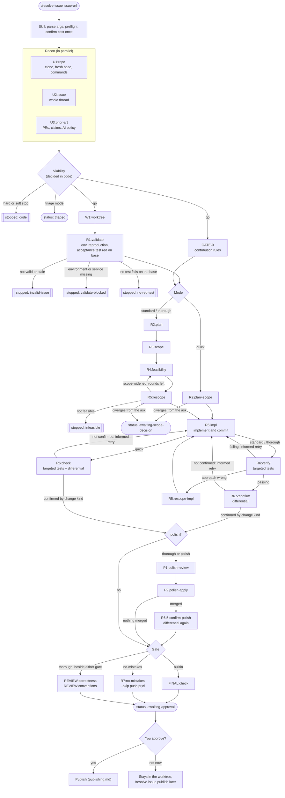

# How it works

`/resolve-issue <issue-url>` runs in two parts:

- **The skill** ([skills/resolve-issue/SKILL.md](../skills/resolve-issue/SKILL.md)) is the front door. It reads your request, checks that the Workflow tool and `gh` are available, asks once about cost, launches the workflow, presents the result and publishes only after you approve.
- **The workflow** ([workflows/pipeline.js](../workflows/pipeline.js), registered as `resolve-issue:pipeline`) does the work. It is a Claude Code dynamic workflow: a script that calls agents in a fixed graph. The script, not the agents, decides which step runs next and when the run stops.

The workflow has no step that pushes, comments, forks or opens a pull request; its agents are told not to, and the publish guard backs that up. It ends with an approval packet. Publishing is a separate step in the skill ([publishing.md](publishing.md)).

## The pipeline at a glance



Some paths are left out of the chart to keep it readable: every step can also stop with `agent-failed`, `agent-budget-reached` or `token-budget-reached`, and attempts can run out (`verify-failed`, `unconfirmed`). See [troubleshooting.md](troubleshooting.md) for every stop.

## Where the work lives

| What | Where |
|---|---|
| Main clone | A clone of the repository in or under your current directory: the repository you are in, or one found up to 3 levels below. A clone counts when any of its remotes points at the repository, whatever the remote's name. If none exists, it clones `https://github.com/<owner>/<repo>.git` with `--filter=blob:none` into `<cwd>/<repo>` (or `<cwd>/<repo>-<owner>` if that path is taken). When your current directory is inside an unrelated repository, it clones next to that repository instead, in the parent directory of its main clone. When you are in a worktree of that repository, such as Claude Code's `.claude/worktrees/<name>`, that is the main clone's parent, not the worktree's. When you are in a submodule, nested or not, the main clone of the outermost superproject counts instead. In a main working tree (a plain clone, a submodule, a clone with a separate git dir), the main clone is that checkout. From a linked worktree, it comes from the first entry of `git worktree list`: that entry's checkout (for a worktree of a submodule, the submodule's checkout), or the entry itself when it is a bare repository or the git dir of a clone made with `--separate-git-dir`. It does not walk further up through enclosing repositories. |
| Worktree | `<clone>-issue-<n>`, a sibling of the clone, on branch `fix/issue-<n>`, created at the freshly fetched upstream base SHA. Your checkout is not touched. |
| Scratch folder | `<worktree>/.resolve-issue/`. It contains a `.gitignore` with `*`, so it ignores itself and `git status` stays clean. |

Files in the scratch folder:

| File | Written by | Purpose |
|---|---|---|
| `repro.<ext>`, `test_acceptance_<n>.<ext>` | R1 | The reproduction and the acceptance test |
| `venv/` | R1 | A Python environment for this worktree, created only when no usable one exists (common for a fresh clone) |
| `site/` | R1 | A missing Python dependency for an existing environment, installed with `--no-deps --target` |
| `spike/` | R4 | Feasibility experiments, never committed |
| `evidence/base-acceptance.txt`, `base-repro.txt`, `base-intree.txt`, `head-acceptance.txt`, `head-repro.txt`, `head-intree.txt` | R6.5, R6:check or R6.5:confirm-polish | Output of the differential, on the base and with the fix. The `intree` files hold the regression tests the fix added or changed in the repository's own test files. |
| `pr-title.txt`, `pr-body.md` | FINAL or R7 | The drafted PR text |
| `intent.txt` | R7 and the skill | The intent passed to no-mistakes. The skill keeps the `Findings already decided (decisions, not omissions):` block at its end. |
| `validation-runs.txt` | R7, and the skill when it re-validates | The ids of the validation runs that R7 and the skill started in no-mistakes' strict launch mode, one per line. Each id comes from the run's launch receipt. The skill reads it before it answers a gate on its own. |
| `gate-evidence/<runId>/` | R7 | A copy of the no-mistakes run evidence (no-mistakes deletes its own after 14 days) |
| `packet.json` | the skill | The whole result, plus the run ID (`runId`) and the latest launch arguments (`launchArgs`). `/resolve-issue publish` reads it, also from a later session. In a session other than the one that started the run, a resume is not possible, so the skill offers a fresh run from `launchArgs` instead ([configuration.md](configuration.md#resuming-a-run) says which arguments it keeps) and asks the cost question first, unless you turned it off or said `yes`. The skill writes it only into a `.resolve-issue` folder that still exists, and writing it may ask you for permission. |
| `decisions.json` | the skill | The decision log: each finding's decision, who made it and why ([publishing.md](publishing.md#finding-decisions-and-autonomy)) |
| `publish-approved` | the skill, after you approve (or, at autonomy `minor` or `full`, for one answer to a validation run) | One-time token for the publish guard ([safety.md](safety.md)). W1 removes any old one when it creates or resumes the worktree. |
| `pr-url.txt` | the skill, after publishing | The opened PR's URL |

Short-lived scratch checkouts (`base/`, `base-final/`) may also appear there while a step compares against the base. The steps remove them afterwards.

## The steps

Each step is one agent call. Its label (as shown in `/workflows`) is in the heading. A label ending in `~retry` is the single automatic retry after an agent returned nothing. Steps that run side by side (`U1` to `U3`, and `GATE-0` beside `W1` and `R1`) make their retry after they all return, in a fixed order. A resume replays only an unchanged sequence of calls, so this keeps it replaying them and every later step from cache. The optional steps (`P1:polish-review`, `P2:polish-apply`, `REVIEW:correctness`, `REVIEW:conventions`) are not retried, so skipping one in `/workflows` is respected. Labels ending in `#N` count rounds or attempts from 0.

### Recon: `U1:repo`, `U2:issue`, `U3:prior-art` (in parallel)

- **`U1:repo`** finds or creates the main clone (see [where the work lives](#where-the-work-lives)), fetches the upstream default branch, and reports the base SHA. It records your `gh` login, whether you can push to the repository, and whether [no-mistakes](https://github.com/kunchenguid/no-mistakes) is installed and initialized there. It reads CI, the task runner and build files at the base to find the test, lint, build and minimal verify commands, the interpreter, and service needs. Triage mode skips U1, so it never clones.
- **`U2:issue`** reads the whole issue thread, linked issues and PRs. It separates symptom from root cause, records maintainer intent, and estimates the fix size (`small`, `medium`, `large`).
- **`U3:prior-art`** gathers viability facts: issue state and labels, PRs that target the issue (by closing keyword, an explicit `#<n>` or a timeline link, never a bare number), your own PRs for it, claims in comments, unmerged fixes without a PR (a branch or a commit that references the issue, in the repository or a fork), whether the repo is archived, days since the last commit, and the AI-contribution policy from CONTRIBUTING, AGENTS.md, CLAUDE.md, AI_POLICY.md and the PR template.

All three recon agents are told to use GitHub read-only: never push, comment, label, react, assign, fork, or create or edit anything. The publish guard's run rule also covers them ([safety.md](safety.md#the-publish-guard)).

**Stops here:** `recon-failed` (U2 or U3 could not read the issue, U2 reported a different issue number, or U1 found no main clone and base SHA), `handoff-failed` (an explicit `gate=no-mistakes`, but U1 found no-mistakes not installed or the repository not initialized for it), `agent-failed`. The `handoff-failed` stop comes right after the viability check, before the worktree and any later agent. After you set no-mistakes up, a resume with the `gateAttempt` that `resume` names continues the run, and the gate checks no-mistakes live.

### Viability (in code, no agent)

The script applies fixed rules to U3's facts:

| Code | Rule | `force` overrides? |
|---|---|---|
| `repo-archived` | The repository is archived | No |
| `repo-rejects-ai-contributions` | The policy is `reject-agentic`: AI-assisted work is refused even when a human submits it | No |
| `already-have-pr` | You already have an open PR for this issue | No |
| `issue-closed` | The issue is not open | Yes |
| `not-viable-label` | A label matches won't fix / wontfix, invalid or duplicate | Yes |
| `competing-pr` | Someone else's open PR targets the issue and was updated in the last 30 days | Yes |
| `claimed` | Someone claimed it in the last 14 days and has an open PR or branch, or a maintainer acknowledged the claim. A claim from the last 7 days stops the run even without those: a claim this recent is presumed active. | Yes |
| `work-in-progress` | Someone has an unmerged change to the project's own code that fixes the issue without a PR (a branch or a commit that references the issue, in the repository or a fork), touched in the last 60 days | Yes |

Weaker signals become warnings, not stops: a competing PR idle for more than 30 days, a claim older than 7 days with no PR, branch or maintainer acknowledgement, or one older than 14 days even with them, unmerged work idle for more than 60 days, a workaround in another repository (such as the reporter's own site, which is not work in progress), no default-branch commit in 180 days, a disclosure requirement, or a ban on autonomous agent submissions.

A claim or unmerged work whose age U3 could not find counts as fresh (0 days), so it stops the run; the reason says "an unknown number of days ago". When several stops apply, the hard ones come first, so `stopped` names a hard stop whenever there is one and `force` is offered only when every stop is soft. The windows are `FRESH_CLAIM_DAYS` (7) and `WIP_DAYS` (60) in [workflows/pipeline.js](../workflows/pipeline.js). An issue that looks free often is not; see [why triage runs first](modes-and-cost.md#why-triage-runs-first).

In triage mode the run ends here with `status: "triaged"`: a verdict (`takeable` or `not-takeable`), blockers, warnings, an issue summary, prior art, the AI policy and a suggested mode (`quick` for small, `standard` for medium, `thorough` for large).

### `W1:worktree` and `GATE-0` (in parallel)

- **`W1:worktree`** creates the worktree at the base SHA with `git worktree add --no-track -b fix/issue-<n>`. If that branch already exists, it reuses the worktree only when an earlier resolve-issue run made it and no PR from it is open. It also checks your fork for the branch. For a created or resumed worktree, it makes sure the scratch folder exists and removes any old approval token. It never resets, forces, stashes, renames or deletes anything.
- **`GATE-0`** reads the contribution rules at the base without checking anything out: CONTRIBUTING, AGENTS.md, CLAUDE.md, `.github/copilot-instructions.md`, the PR template, style config, changelog conventions, DCO and CLA rules, and the last 20 commit subjects. Notes in your own context (such as a memory file) are checked against the code; contradictions are reported as warnings. GATE-0 keeps running while W1 and R1 work, and the plan waits for it. If GATE-0 returns nothing, its retry runs after R1. It is told never to push, comment or write to GitHub.

**Stops here:** `prior-branch-exists` (the branch exists outside resolve-issue's own worktree, or backs a PR), `worktree-failed` (W1 returned an unexpected branch or path), `agent-failed`.

### `R1:validate`

R1 owns the environment, the reproduction and the oracle. It runs the minimal verify command. If no usable environment exists (common for a fresh clone), it creates one for this worktree only:

- Python: `uv venv` (or `python3 -m venv`) in `<worktree>/.resolve-issue/venv`, with an editable install of the worktree and the dependencies its tests need;
- Node: the lockfile's install command, inside the worktree;
- Rust and Go: the toolchain's own fetch.

If an environment exists but lacks a dependency declared at the base, R1 installs just that one, with no dependencies, into `.resolve-issue/site` (Python). It is told never to install into the main clone's environment, a shared virtualenv or your global environment, and to make no editable install outside `.resolve-issue/venv`. That is a prompt, not a control. For Python it confirms that imports resolve to the worktree, not to another checkout.

It then reproduces the issue at the base, writes the reproduction and an acceptance test, and records whether the test fails on the base (`acceptanceRedOnBase`). A maintainer-supplied test from the thread is vetted: R1 keeps the assertion the maintainer wants and repairs the mechanics.

If the environment or a service the tests need cannot be set up (a database, Docker, a GPU, network access, a missing toolchain), R1 reports `envBlocked` and says what is missing. It never treats that as an invalid issue.

If the reported behavior is correct, R1 asks whether a clearer message or doc would have prevented the report. If so, the change becomes a `diagnostics` or `docs` change. Otherwise the issue is not valid.

**Stops here:**

- `validate-blocked`: R1 could not set up the environment or a service. The worktree is kept. After you fix what `reason` names, resume with the `validateAttempt` that `resume` names, so R1 runs again.
- `invalid-issue`: not a defect, or already fixed at the base. Environment trouble never leads here. The result carries `draftComment`, a short reply you may post yourself. The run removes the worktree and branch it created, only if they hold no work; after that, the stop reports `worktreePath` and `branch` as `null`.
- `no-red-test`: the issue is real, but R1 could not write an acceptance test that fails on the base, so a `behavior` fix could not be proven. Resume with the `validateAttempt` that `resume` names to let R1 try again, or stop.

### Plan and scope

The shape depends on the mode.

- **quick: `R2:plan+scope`.** One agent plans the root-cause fix and scopes it to the smallest change.
- **standard and thorough:** `R2:plan` plans the root-cause fix. `R3:scope` sets a first-pass scope. Then a loop runs: `R4:feasibility#N` spikes the riskiest assumptions in `.resolve-issue/spike` (never on the branch) and runs the affected tests at the base; `R5:rescope#N` settles the scope from those findings. If the scope widened and rounds remain (2 in standard, 3 in thorough), feasibility runs again on the new scope. If it widens at the cap, it is accepted with a warning.

Every scope lists files and APIs touched and explicit out-of-scope items. When a shared mechanism is the root cause, it is fixed once and the siblings it does not cover are listed as out of scope.

**Stops here:** `infeasible` (R5 found a hard wall; the run removes the worktree and branch it created, only if they hold no work), `status: "awaiting-scope-decision"` (see [the scope gate](#the-scope-gate)), `agent-failed`.

### Implement, verify, confirm

Each attempt (2 in quick, 3 in standard, 4 in thorough by default):

1. **`R6:impl#N`** reads the sibling code that already does this correctly in full, then its own target files, and implements the scope. It preserves native semantics: no new validation or restrictions unless the reference sibling already has them or the code would otherwise return a silently wrong result. It updates docstrings, docs and changelog lines the change makes false. For a `behavior` change, it adds or extends a regression test in the repository's own test files that fails without the fix. Tests assert the contract, not message wording. It commits on `fix/issue-<n>` following the repo's commit convention (`git commit -s` when DCO applies), with no trailers and no tool names.
2. **Check.**
   - quick: **`R6:check#N`** is one fresh, skeptical agent that runs the targeted check, then the differential. It reports `part2Ran`. A check that failed the targeted part is a failed attempt. A check that passed it but never ran the differential is not: the attempt is used up, and the next implementer keeps the code and commits nothing unless it finds a real problem. If the attempts run out after a check that passed the targeted part, the stop is `unconfirmed`. If no attempt ran the differential, its reason says the differential did not run; otherwise `lastFailure` shows the last differential that did run. Neither case is a damaged tree.
   - standard and thorough: **`R6:verify#N`** runs the targeted check (build or import, the acceptance test, tests for the touched files, the reproduction). If it passes, **`R6.5:confirm#N`**, a fresh skeptical reviewer, runs the differential.
3. **Decide (in code).** The script judges confirmation by change kind (see below). A failure becomes an informed retry: the next `R6:impl` gets the specific failures and fixes them instead of starting over.

In standard and thorough, when verification shows the approach itself is wrong (`needsRescope`), **`R5:rescope-impl#N`** re-scopes before the next attempt (once in standard, twice in thorough). A re-scope does not use up an attempt. The implementer is told to revert the rejected approach's commits with `git revert`.

The targeted check sorts failures. Failures caused by the change drive the retry. Missing optional dependencies, pre-existing failures and environment issues are listed as ignored, and skipped tests count as neither pass nor fail.

**Stops here:** `verify-failed` (no green build, tests and reproduction within the attempts), `unconfirmed` (the targeted check passed but the differential did not confirm), `infeasible-after-impl`, `tree-damaged` (a check left the worktree dirty or off the expected head; after you restore it, resume with the `confirmAttempts` map that `resume` names, so only the attempts it names re-run their check), `status: "awaiting-scope-decision"`, `agent-failed`.

### Polish: `P1:polish-review`, `P2:polish-apply`, `R6.5:confirm-polish`

Runs in thorough mode, or in any mode with `polish`. P1 reviews the diff as a maintainer of this repo would, using the nearest tests and the last 5 merged PRs for local conventions. It lists at most 8 items, limited to lines the diff changed. It never proposes features, validation or scope changes. P2 applies them on a temporary branch `fix/issue-<n>-polish`, re-runs the checks, and fast-forwards `fix/issue-<n>` only if they pass. Otherwise it deletes the temporary branch and the confirmed head stays.

When a polish pass merges, a fresh agent, **`R6.5:confirm-polish`**, runs the same differential on the polished head. If the polished head fails it, the run still returns the packet. The packet then carries a `blocker` finding and a warning that names the last confirmed head, so you can drop or fix the polish commits before publishing. If the final check reports a head other than the last one a differential proved (for example, your own commits added after the last check, or a polish pass that reported no valid head), the packet warns and names both heads. When a polish pass ran without reporting a valid merge, such a head also carries a `blocker` finding, because polish commits may be in it.

A failed polish review or apply does not stop the run; the packet says what happened. The re-check can stop it with `tree-damaged` or `agent-failed`.

### Final check

Publishing is disabled in both gates. The gate is chosen by `gate`: `auto` uses no-mistakes when it is installed and the repository is already initialized for it, and the built-in check otherwise. The no-mistakes gate needs no-mistakes v1.84.0 or later.

**Built-in: `FINAL:check`:**

1. Precondition: a clean tree, on `fix/issue-<n>`, with the confirmed head as an ancestor of HEAD (you may have added commits).
2. Wider tests: none in quick mode, the test modules for every touched file and package in standard, and the full suite in thorough when it finishes in about 15 minutes. A failure is re-run at the base before it is blamed on the change, at B, the branch's merge-base with the fetched base (the base itself on a fresh branch), in a scratch worktree.
3. Lint on the changed files, reporting only lines the diff touched. It fixes nothing.
4. A maintainer-eye review. It receives the independent checker's notes (`introducedDefects` from `R6.5:confirm` or `R6:check`), checks each against the diff, and reports the real ones as findings and drops the rest. Findings are numbered `F1`, `F2`, ... with a severity (`blocker`, `should-fix`, `nit`) and a recommendation: `fix`, `low-impact`, `decline` or `note` ([publishing.md](publishing.md#finding-decisions-and-autonomy) has the rule). A `low-impact` finding carries its evidence in `impact`: a count from real data when it is cheap to get, or the unusual input it needs. The unusual input alone is enough evidence. The script counts a `low-impact` finding without evidence as `fix`. Findings from the extra reviewers are merged in. Findings with the same file, the same first line number and the same first 60 letters and digits of the description become one, at the higher severity and recommendation; `alsoReported` keeps the other wording.
5. The diffstat and the PR title and body.

**no-mistakes: `R7:no-mistakes`** writes `intent.txt` and starts exactly one validation run. The intent quotes the issue title as data, not instructions, and replaces absolute local paths (such as home or temporary folders) with `<path>`:

```
no-mistakes axi run --skip push,pr,ci --no-publish-intent --intent "$(cat '<worktree>/.resolve-issue/intent.txt')" \
  --launch-nonce "ri-<n>-$(date +%s)-$$" --validation-generation resolve-issue-validation
```

R7 starts each run in no-mistakes' strict launch mode and records the run id from its launch receipt. It reattaches only to a recorded run. It leaves any other run on the branch alone and stops with `handoff-failed`. It reattaches with `--wait 8m` at most 5 times. It never runs `axi respond`, `axi abort`, `--yes` or `axi sync` without `--check`. It reports the steps, findings, what the gate itself committed (`gateCommits`), the branch-sync action, copies the run's evidence, and drafts the PR text. It recommends an action for each no-mistakes finding, by the same rule as the built-in review. For evidence, it may run at most three quick probes that change no tracked file. It also receives the independent checker's notes (`introducedDefects`), checks each against the diff, and reports the real ones as known defects. They join `gate.reviewFindings` as `RV` items.

**Extra reviewers (thorough mode).** `REVIEW:correctness` and `REVIEW:conventions` run in parallel beside either gate. They change no files. With the built-in gate, their findings are merged into `gate.findings`. With no-mistakes, they join R7's known defects in `gate.reviewFindings`. The script numbers that list `RV1`, `RV2`, ..., so its items cannot be mistaken for no-mistakes' own ids. It merges repeats the same way. The reviewers start just before the gate's own agent, so a resume that re-runs only the gate (`gateAttempt`) replays them from cache. They take only the slots the agent cap leaves after one for the gate: near the cap the packet comes back without them, and `warnings` says how many did not run. A token budget that runs out does the same, and the warning says so. If the cap leaves no slot for the gate's own agent, the run stops with `agent-budget-reached`.

**Stops here:** `final-check-failed` (the built-in precondition failed), `handoff-failed` (the validation run did not start, or it started and failed; then `gate.steps` and `gate.findings` show why, and a resume starts a new validation run on the same head), `gate-still-running` (the no-mistakes run is still going after the last reattach), `agent-failed`. A resume of `handoff-failed` or `gate-still-running` from this step, with the `gateAttempt` that `resume` names, goes straight into the gate. The gate checks no-mistakes live and reattaches to a recorded run that is still going. An explicit `gate=no-mistakes` on a repository that cannot run it stops earlier, right after recon. After the early stop, a resume runs every step after recon, and the gate checks no-mistakes live. If no-mistakes reports that a push, PR or CI step ran, the status is `went-remote-without-approval`.

### Result

`status: "awaiting-approval"` with the approval packet: the change summary, test evidence, findings, PR text paths, constraints (DCO, CLA, draft or human testing required), warnings, the `publish` details and a `cleanup` command. See [publishing.md](publishing.md).

## Design choices

### Decisions in code, not in agents

Agents gather facts and return structured data against a schema. The script makes the decisions that matter:

- **Viability.** The stop rules above are plain code over U3's facts, so an agent cannot talk itself past an archived repo or an AI ban.
- **Confirmation by change kind.** The checker reports separate booleans; the script decides, and a field the checker left out never counts as proof. Every kind needs `greenWithFix` and `treeIntact: true`. Then:

  | Kind | Also required |
  |---|---|
  | `behavior` | `redOnBase` (the acceptance test fails on the base), `intreeRedOnBase` (a regression test the fix added or changed in the repository's own test files fails on the base and passes at HEAD), `testGuardsBug` (a wrong implementation could not pass) and `testPinsSemantics` (asserts the contract, not incidental text) |
  | `diagnostics` (only messages, warnings or errors changed) | `behaviorPreserved` and `reproShowsNewOutput` |
  | `docs` | `behaviorPreserved`. A change counts as `docs` only when the checker reports `codeChanged: false`; otherwise it is judged as `behavior` |

- **The scope gate key.** A halt for a scope decision carries a `gateKey` built from the node and a hash of the exact question and files. Each gate takes only the answer with its own key, so your answer applies to that proposal only. If a resumed run produces a different proposal, it halts again.

### The scope gate

A run halts with `status: "awaiting-scope-decision"` only when the responsible fix changes a public API or contract, widens the security surface, contradicts a maintainer-stated requirement, or no code change is responsible. Every other judgement call is recorded in the plan's `decisionsTaken` and does not halt. You answer `proceed` or `abort`; `abort` ends with `user-declined-wider-scope`.

The halt returns `gateKey` and `earlierDecisions` (the gates this run already passed). The skill resumes with `scopeDecisions`: every entry in `earlierDecisions`, plus `{ key: <gateKey>, answer: "proceed" | "abort" }` for this gate. A run that halts twice therefore needs both answers. A single `scopeDecision` object is still accepted, and an answer without a key answers the first gate it meets.

### Fresh base, isolated worktree

U1 fetches the upstream default branch and W1 branches from that exact SHA, never from a stale local default branch. All work happens in a separate worktree, so your checkout and its uncommitted changes are untouched. Agents are told never to fetch, pull, merge, rebase, reset or stash the branch.

### Reproduce first

R1 writes the acceptance test before any fix and records whether it fails on the base. If no such test fails on the base, a `behavior` run stops with `no-red-test` before any fix is written. The confirm step later proves the same test goes from red to green, and that the regression test the fix ships in the repository's own test files does too. A fix without a failing test first is not a confirmed `behavior` fix.

### The differential, without `git stash`

To prove red on the base, the checker first finds B, the branch's merge-base with the fetched base: the base itself on a fresh branch, or an older commit when a resumed branch forks from an older base. It restores only the changed non-test source files to B with `git restore --source=<B>`, and names B's SHA in its report. It keeps the test files at HEAD, rebuilds if the tests use build output, and runs the acceptance test, the reproduction and the in-tree tests the fix added or changed. Then it restores the sources to the head and rebuilds again. All of this runs in one shell command, so the restore always runs. It never uses `git stash`: `refs/stash` is shared by every worktree of a clone, so a stash could take someone else's work. The output lands in `.resolve-issue/evidence/`, and the PR's Testing section is written only from those files and the commands the checks recorded.

### Plain-prose PR text

The PR title, body, commit bodies and suggested replies follow fixed rules: one idea per sentence, at most 25 words, one term per thing, active voice, quoted text left exactly as it is. The body starts with `Resolves #<n>.`, follows the repo's PR template (or Summary / Changes / Testing / Notes), stays under 30 lines, contains no local paths, and names no tool or agent outside a required disclosure. The repo's conventions win where they conflict.

### Resumable from cache

Every stop says where the work is and how to continue in its `resume` field. Re-invoking the workflow with the run's `resumeFromRunId` and the same args replays finished steps from cache, so you pay only for new work. Some stops name an extra argument that makes one step run again instead of replaying it, such as `retryNodes` after `agent-failed` or `validateAttempt` after `validate-blocked`. `retryNodes` and `confirmAttempts` are maps that keep every earlier entry, so a later stop never reverts an earlier one. A resume works only in the Claude Code session that started the run. Verdicts (such as `invalid-issue` or `infeasible`) say in `resume` that they are final, because a resume would replay the same answer. A hard viability stop (such as `repo-archived`) says it is not overridable; a resume replays it too. See [configuration.md](configuration.md#resuming-a-run).
